<div align="center">

  

  # 🍳 CookSmart AI

  ### *Smart Culinary Assistant Powered by Google Gemini & Flutter*

  <p align="center">
    Turn whatever ingredients are in your pantry into delicious, personalized recipes in seconds.
    Designed with a warm modern aesthetic, multi-tier AI cascading, offline-first storage, interactive guided cooking, and crystal-clear plain English instructions.
  </p>

  <p align="center">
    <a href="https://flutter.dev"></a>
    <a href="https://dart.dev"></a>
    <a href="https://deepmind.google/technologies/gemini/"></a>
    <a href="https://firebase.google.com"></a>
    <a href="LICENSE"></a>
  </p>

  <p align="center">
    <a href="#-features-showcase--screenshots">Visual Gallery</a> •
    <a href="#-detailed-feature-breakdown">Feature Deep Dive</a> •
    <a href="#-architecture--tech-stack">Architecture</a> •
    <a href="#-getting-started">Getting Started</a> •
    <a href="#-project-structure">Project Structure</a> •
    <a href="#-testing--code-quality">Testing</a>
  </p>

</div>

---

## 📱 Features Showcase & Screenshots

Explore CookSmart AI in action across every primary workflow and feature. All screenshots captured directly on an Android emulator.

### 1. Welcome & Authentication
Secure cloud authentication via Firebase with seamless zero-friction guest access for offline cooking.

| 🔐 Sign In & Welcome | 📝 Chef Account Registration |
| :---: | :---: |
| 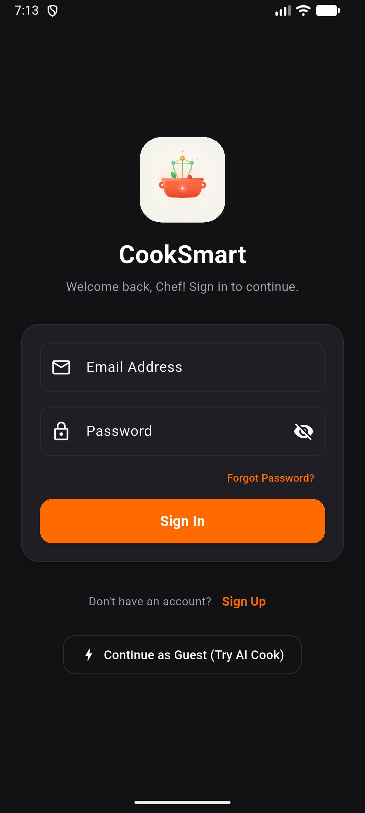 | 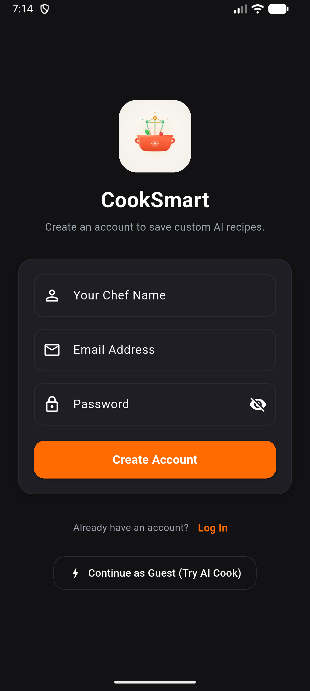 |
| *Email & password sign in, password visibility toggle, forgot password recovery dialog, and Instant Guest access.* | *Chef registration allowing personalized display names and automatic cloud sync initialization.* |

---

### 2. Home Dashboard & Theme Engine
Discover curated gourmet meals, explore quick pantry actions, and effortlessly toggle between Daylight and Night Kitchen themes.

| 🌙 Night Kitchen (Dark Mode) | ☀️ Daylight (Light Mode) |
| :---: | :---: |
| 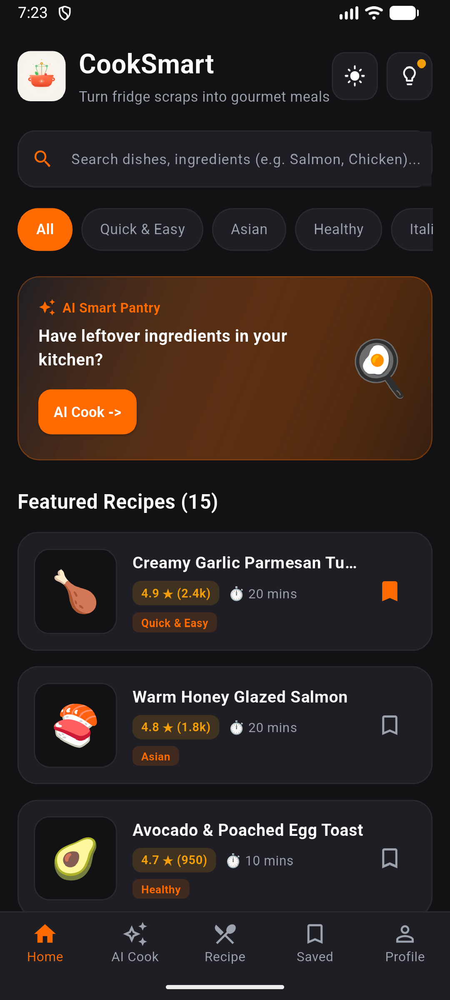 | 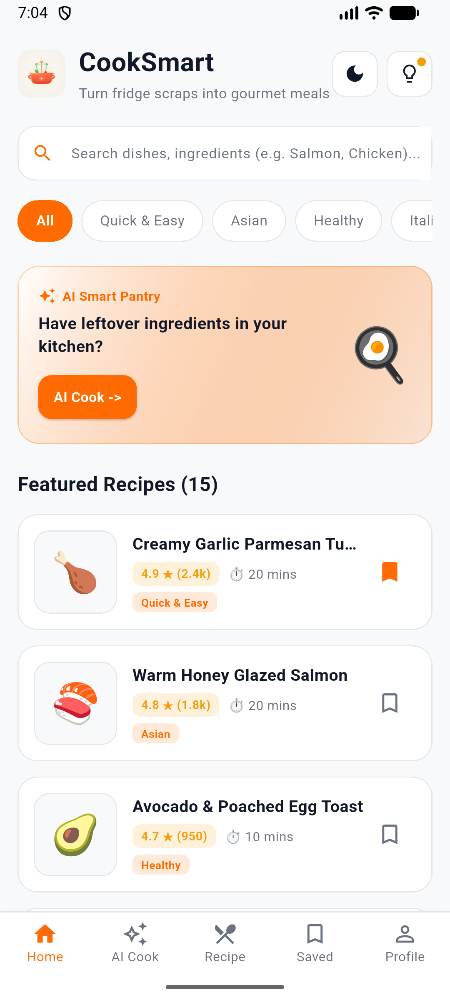 |
| *Deep slate backdrop (`#121212`) paired with rich terracotta accents (`#FF6B00`) for low-light kitchen cooking.* | *Clean, high-contrast cream background with warm terracotta tones optimized for bright daylight cooking.* |

---

### 3. Culinary Discovery & Smart Search
Filter through hand-crafted global dishes or search recipes by specific ingredients in real time.

| 👨‍🍳 Daily Chef Secrets | 🔍 Real-Time Ingredient Search |
| :---: | :---: |
| 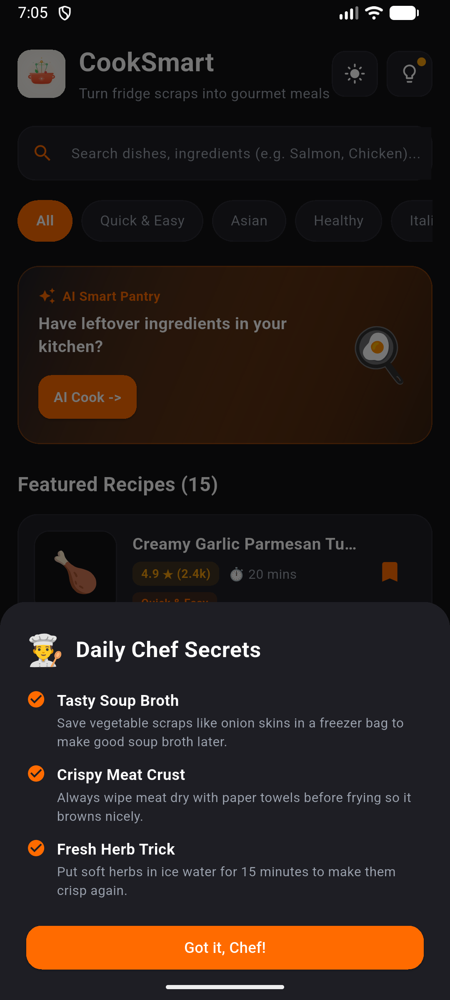 | 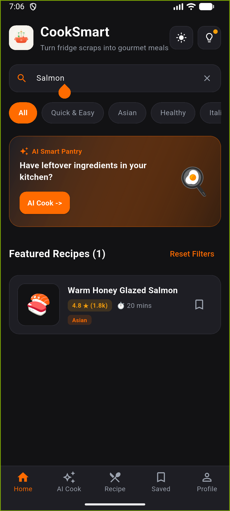 |
| *Quick-access bottom sheet with actionable culinary hacks (saving scraps for broth, searing techniques, fresh herb revival).* | *Instant 300ms debounced search filtering dishes by title or ingredients (e.g., Salmon) with one-tap reset.* |

---

### 4. Intelligent AI Recipe Synthesis (AI Cook)
Transform whatever ingredients are currently in your fridge into balanced, personalized meals.

| 🥕 Pantry Staples & Tagging | ⚙️ Dietary Filters & Preferences | ⏳ AI Synthesis in Progress |
| :---: | :---: | :---: |
| 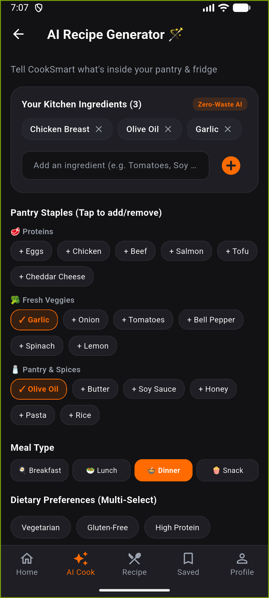 | 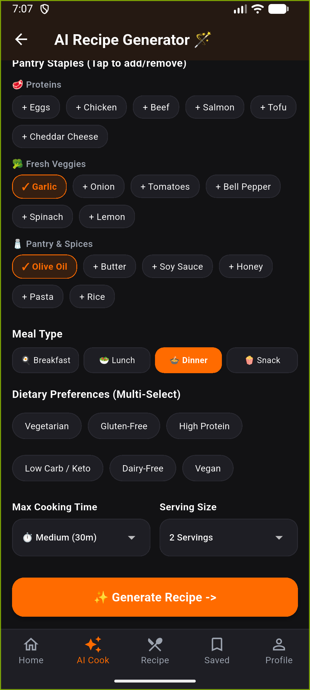 | 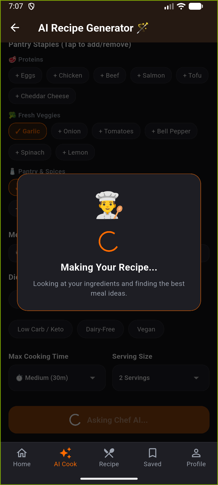 |
| *Interactive ingredient tags with one-tap addition of pantry staples (Proteins, Veggies, Spices).* | *Multi-select dietary filters (Keto, Vegan, High Protein), course types, cooking times, and servings.* | *Animated Chef AI loading modal featuring multi-model cascading fallback.* |

---

### 5. Detailed Recipe View & Dynamic Tweaks
Crystal-clear plain English instructions, interactive ingredient checklist, and instant on-the-fly AI tweaks.

| 📋 Recipe Overview & Tweak Chips | 📖 Plain-English Steps & Chef Tip |
| :---: | :---: |
| 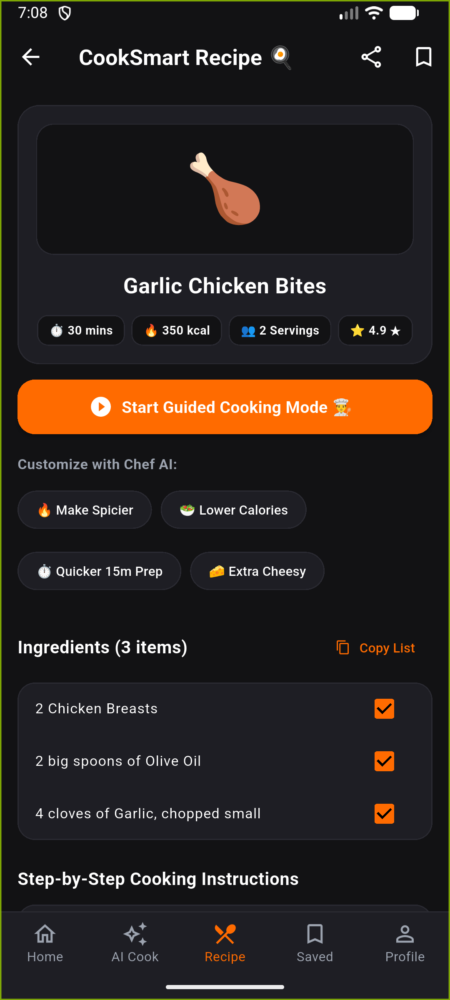 | 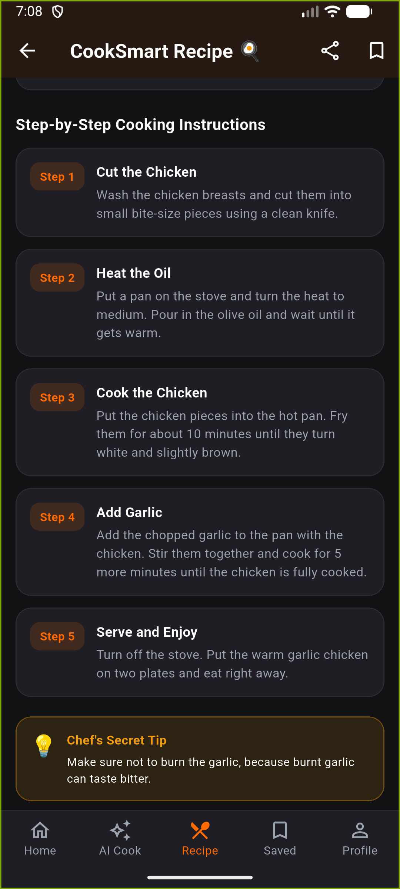 |
| *Nutritional badges (time, calories, servings, rating), one-tap AI adjustments ("Make Spicier", "Lower Calories"), and checklist.* | *Step-by-step instructions with everyday language (no confusing culinary jargon) and pro chef secret tips.* |

---

### 6. Guided Cooking Mode with Built-in Kitchen Timer
Full-screen distraction-free cooking walkthrough designed for hands-on meal preparation.

| 👨‍🍳 Step-by-Step Guided Mode | ⏱️ Built-in Kitchen Timer Running |
| :---: | :---: |
| 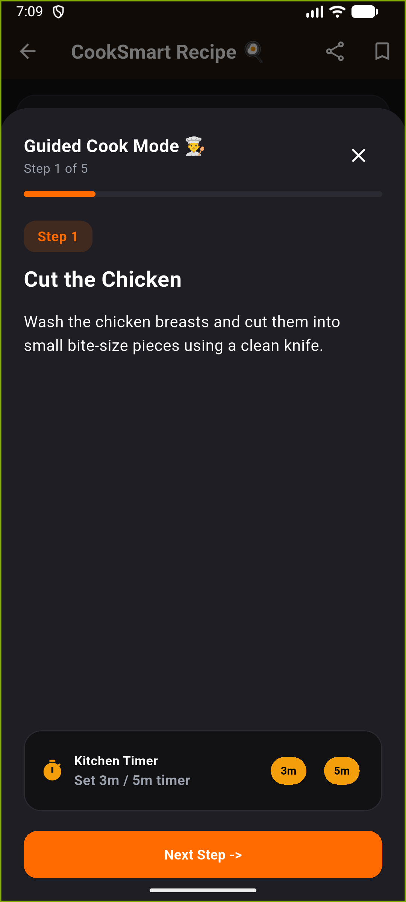 | 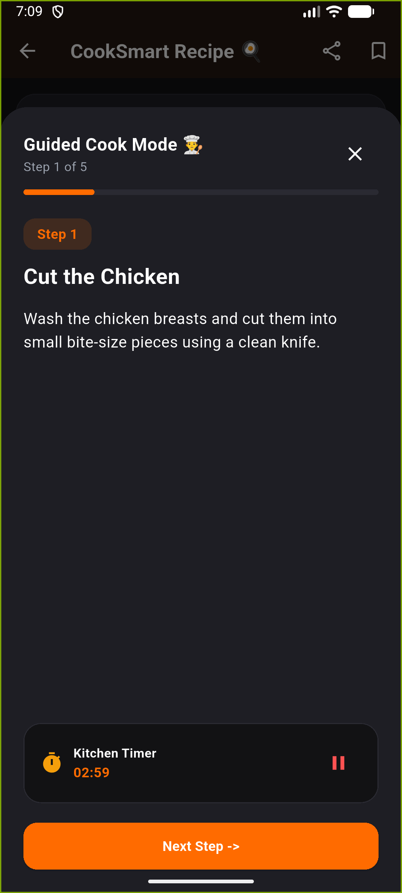 |
| *Full-screen card view with progress bar, large readable fonts, and simple navigation between steps.* | *Integrated countdown timer with 3m/5m quick presets, pause/resume, and celebratory completion sound/snack.* |

---

### 7. Recipe Cookbook & Consolidated Grocery List
Manage your personal culinary library in your preferred layout and generate grocery shopping lists with one tap.

| 🗂️ 2-Column Grid Cookbook | 📑 Detailed List View | 🛒 Smart Grocery List Aggregator |
| :---: | :---: | :---: |
| 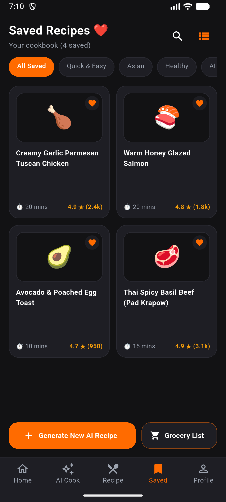 | 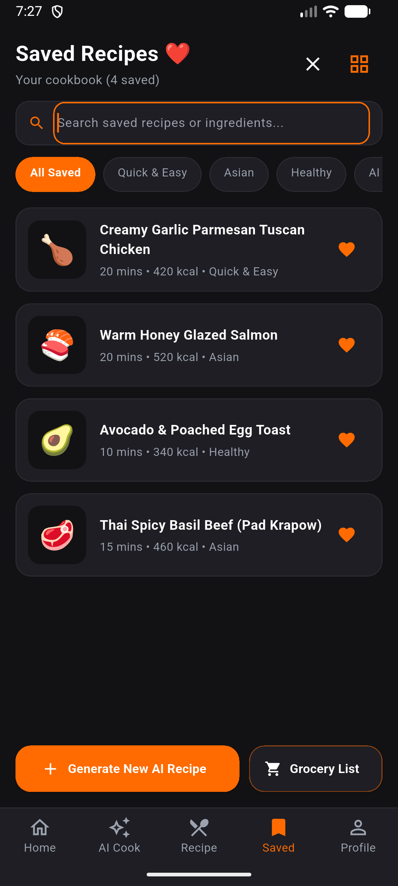 | 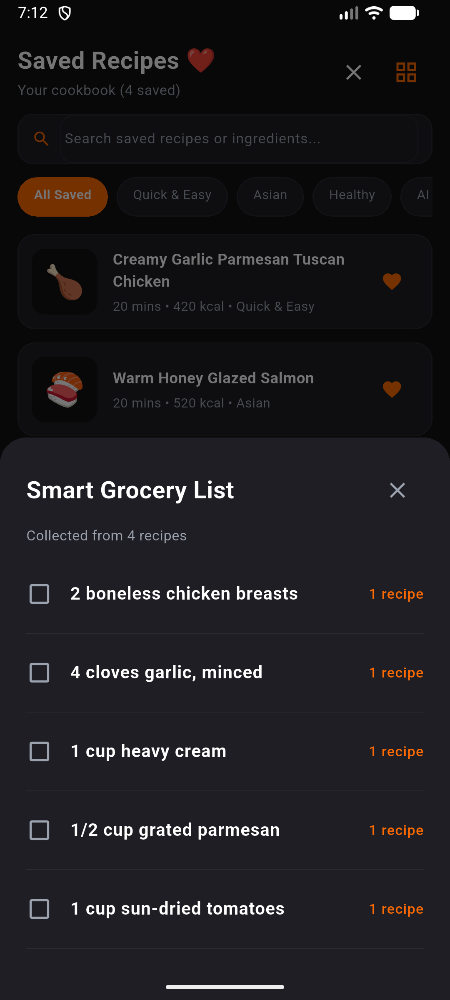 |
| *Visual card grid showing recipe emojis, cooking durations, star ratings, and instant unfavorite buttons.* | *Compact list layout with recipe metadata and swipe-to-delete with 3-second Undo snackbars.* | *Automatically aggregates ingredients across all saved recipes into a consolidated shopping checklist.* |

---

### 8. Chef Profile & Settings
Monitor cooking activity stats, toggle theme preferences, and sync recipes across devices.

<div align="center">
  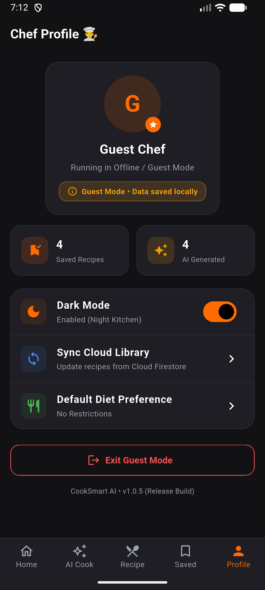
  <p><em>Track saved recipes and AI generation counts, toggle dark/light theme, sync with Cloud Firestore, and manage preferences.</em></p>
</div>

---

## 🌟 Detailed Feature Breakdown

### 🪄 1. Intelligent AI Culinary Synthesis
- **Zero-Waste Pantry Cooking**: Type custom ingredients or tap curated pantry staples (Proteins, Vegetables, Seasonings) to immediately generate cohesive meal plans.
- **Precision Parameters**: Select exact cooking duration limits (`<15m`, `30m`, `45m+`), serving sizes (`1 Person`, `2 Servings`, `4 Family`, `6+ Feast`), and meal courses (`Breakfast`, `Lunch`, `Dinner`, `Snack`).
- **Multi-Select Dietary Preferences**: Combine multiple lifestyle constraints simultaneously, including Vegetarian, Vegan, Gluten-Free, High Protein, Low Carb / Keto, and Dairy-Free.

### 🗣️ 2. Plain English Language Guarantee
- **Jargon-Free Culinary Steps**: Instructions strictly avoid confusing terminology (no *"deglaze"*, *"julienne"*, *"chiffonade"*, or *"braise"* without clear context).
- **Everyday Kitchen Instructions**: Descriptions use practical, approachable wording like *"cut into small bite-size pieces using a clean knife"* or *"fry until white and slightly brown"*, empowering cooks of all skill levels.

### ⚡ 3. Multi-Tier AI Cascading Engine & Fallback
- **Intelligent Model Selection**: Dynamically routes requests through tier-based models to ensure maximum speed and quality:
  - **Tier 1 (Fast & Agile)**: Powered by `gemini-1.5-flash`, `gemini-2.0-flash`, and `gemini-1.5-flash-8b`.
  - **Tier 2 (Gourmet & Complex Diets)**: Backed by `gemini-1.5-pro` and `gemini-2.0-flash`.
- **In-Memory Cache**: Built-in query cache prevents redundant network round-trips and reduces token overhead.
- **Zero Raw Crashes**: Graceful fallback handling ensures the user always receives a friendly explanation if the network drops or quotas are reached.

### 🔄 4. Live On-The-Fly Recipe Customization
- **Instant Recipe Iterations**: Want to alter a recipe without re-entering ingredients? Tap quick-tweak chips:
  - 🔥 **Make Spicier**: Infuses chilies and warming spices into the existing recipe.
  - 🥗 **Lower Calories**: Replaces high-calorie components with lighter culinary alternatives.
  - ⏱️ **Quicker 15m Prep**: Streamlines cooking steps for fast weeknight dining.
  - 🧀 **Extra Cheesy**: Adds rich cheese melt recommendations.

### 👨‍🍳 5. Fullscreen Guided Cooking Mode
- **Hands-Free Focus**: Distraction-free full-screen modal showing one step at a time with a clear visual progress tracker.
- **Built-in Kitchen Countdown Timer**: Features instant 3-minute and 5-minute quick presets, interactive countdown display, pause/resume capability, and finish alerts.

### 📚 6. Dual-Mode Cookbook & Smart Grocery List
- **Grid & List Views**: Switch between an image-rich 2-column card grid and a compact list view.
- **Consolidated Grocery List**: With a single tap, CookSmart extracts and aggregates all ingredients across all saved recipes into an interactive grocery checklist.
- **Swipe-to-Delete with Undo**: Recipes can be swiped away with an immediate 3-second Undo notification snackbar.

### 🎨 7. Calibrated Light & Dark Theme System
- **Terracotta Brand Identity**: Specially tuned Material 3 color system (`#FF6B00` primary, `#FFB020` secondary amber).
- **System Persistence**: User theme choice is stored in local storage (`SharedPreferences`) and preserved across app sessions.

### ☁️ 8. Dual-Layer Storage (Offline-First + Cloud Firestore)
- **Immediate Local Persistence**: Saved recipes, custom parameters, and statistics update instantly in local storage.
- **Optional Cloud Sync**: Authenticated users can back up their cookbook to Cloud Firestore (`users/{uid}/recipes`) for seamless multi-device access.
- **Guest Mode Support**: CookSmart remains 100% usable in offline/guest mode without mandatory registration.

---

## 🏗️ Architecture & Tech Stack

CookSmart follows a clean, reactive layered Flutter architecture powered by `provider`:

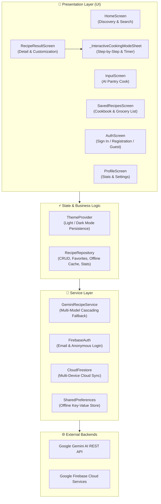

### Technology Breakdown

| Component | Technology | Description |
| :--- | :--- | :--- |
| **Framework** | [Flutter 3.x](https://flutter.dev) | High-performance, cross-platform UI toolkit |
| **Language** | [Dart 3.x](https://dart.dev) | Modern client-optimized language with null safety |
| **AI Backend** | [Google Gemini REST API](https://ai.google.dev/) | Multimodal LLMs for recipe synthesis and adaptation |
| **State Management** | [`provider`](https://pub.dev/packages/provider) | Reactive dependency injection and clean state separation |
| **Authentication** | [`firebase_auth`](https://pub.dev/packages/firebase_auth) | Secure email authentication with guest mode fallback |
| **Cloud Storage** | [`cloud_firestore`](https://pub.dev/packages/cloud_firestore) | Real-time multi-device database synchronization |
| **Local Persistence**| [`shared_preferences`](https://pub.dev/packages/shared_preferences) | Offline-first local key-value and JSON caching |
| **Networking** | [`http`](https://pub.dev/packages/http) | Resilient REST HTTP client with retry and timeout logic |

---

## 📁 Project Structure

```text
cooksmart/
├── assets/
│   └── images/
│       ├── app_icon.jpg             # High-resolution application brand icon
│       └── logo.jpg                 # CookSmart header & branding asset
├── docs/
│   └── screenshots/                 # High-resolution feature screenshot gallery
│       ├── 00_auth_signin.png
│       ├── 00_auth_signup.png
│       ├── 01_home_screen_dark.png
│       ├── 01_home_screen_light.png
│       ├── 03_daily_chef_secrets.png
│       ├── 04_search_and_filter.png
│       ├── 05_ai_cook_input.png
│       ├── 05_ai_cook_preferences.png
│       ├── 06_ai_generating_loading.png
│       ├── 07_recipe_detail_top.png
│       ├── 07_recipe_detail_steps.png
│       ├── 08_guided_cooking_mode.png
│       ├── 08_guided_cooking_timer_active.png
│       ├── 09_saved_recipes_grid.png
│       ├── 10_saved_recipes_list.png
│       ├── 11_smart_grocery_list.png
│       └── 12_chef_profile_screen.png
├── lib/
│   ├── config/
│   │   ├── api_keys.dart            # API keys (gitignored for security)
│   │   └── api_keys.example.dart    # Template configuration file
│   ├── models/
│   │   └── recipe_model.dart        # Recipe, Ingredient, and Step models
│   ├── providers/
│   │   └── theme_provider.dart      # Dark/Light theme state & persistence
│   ├── screens/
│   │   ├── auth_screen.dart         # Sign In, Registration & Guest access
│   │   ├── home_screen.dart         # Featured recipes & smart quick-actions
│   │   ├── input_screen.dart        # Pantry input, dietary preferences & AI synthesis
│   │   ├── profile_screen.dart      # Activity stats, theme switch & cloud sync
│   │   ├── recipe_result_screen.dart# Cooking instructions, tweak chips & guided cook mode
│   │   └── saved_recipes_screen.dart# Dual-view cookbook with search & grocery list
│   ├── services/
│   │   ├── gemini_recipe_service.dart# Google Gemini multi-model cascading service
│   │   └── recipe_repository.dart   # Repository managing local & Firestore sync
│   ├── theme/
│   │   └── app_theme.dart           # Theme tokens, colors, and Material 3 styles
│   ├── utils/
│   │   └── debouncer.dart           # Debounce utility for real-time search
│   └── main.dart                    # Application entrypoint & bottom shell navigation
├── test/
│   ├── error_handling_test.dart     # Friendly error message unit tests
│   ├── recipe_model_test.dart       # JSON serialization unit tests
│   └── widget_test.dart             # Full bottom navigation & widget render tests
├── pubspec.yaml                     # Project dependencies & asset configs
└── README.md                        # Documentation
```

---

## 🚀 Getting Started

### Prerequisites

- [Flutter SDK](https://docs.flutter.dev/get-started/install) (`>= 3.0.0`)
- [Dart SDK](https://dart.dev/get-dart) (`>= 3.0.0`)
- An [Android Device / Emulator](https://developer.android.com/studio) or Chrome browser
- A [Google Gemini API Key](https://aistudio.google.com/app/apikey) (Free tier available)
- *(Optional)* A [Firebase Project](https://console.firebase.google.com) for cloud features

### 1. Clone the Repository

```bash
git clone https://github.com/Abu-Sarfaraz/cooksmart.git
cd cooksmart
```

### 2. Install Dependencies

```bash
flutter pub get
```

### 3. Configure Your Gemini API Key

Copy the example configuration to create your local key file:

```bash
cp lib/config/api_keys.example.dart lib/config/api_keys.dart
```

Open `lib/config/api_keys.dart` and paste your Gemini API key:

```dart
// lib/config/api_keys.dart
const String geminiApiKey = 'YOUR_GEMINI_API_KEY_HERE';
```

> **Security Note**: `lib/config/api_keys.dart` is in `.gitignore` to prevent secret exposure.

### 4. Run the Application

#### On Connected Android Device or Emulator:
```bash
flutter run -d android
```

#### On Chrome (Web Browser):
```bash
flutter run -d chrome
```

#### On Web Server:
```bash
flutter run -d web-server --web-port=9090
```
Then visit `http://localhost:9090` in your browser.

---

## 🧪 Testing & Code Quality

CookSmart maintains strict code standards with full static analysis and comprehensive test coverage.

### Run Static Analysis
```bash
flutter analyze
```

### Run All Unit & Widget Tests
```bash
flutter test
```

### Test Suite Overview
- `test/widget_test.dart`: End-to-end UI rendering and navigation across all bottom tabs.
- `test/recipe_model_test.dart`: Serialization, deserialization, and schema integrity validation.
- `test/error_handling_test.dart`: Friendly error messaging and exception handling assertions.

---

## 🔒 Security & Privacy Guardrails

- **Isolated Credentials**: API keys and secrets are strictly isolated from version control.
- **Offline & Guest First**: Zero mandatory tracking or account creation required for full culinary synthesis.
- **User Scoped Cloud Storage**: Cloud Firestore records are isolated strictly to the authenticated user ID (`users/{uid}/recipes`).

---

## 📄 License

This project is open-source and available under the [MIT License](LICENSE).

<div align="center">
  <sub>Built with ❤️ by Abu Sarfaraz using Flutter & Google Gemini AI</sub>
</div>
