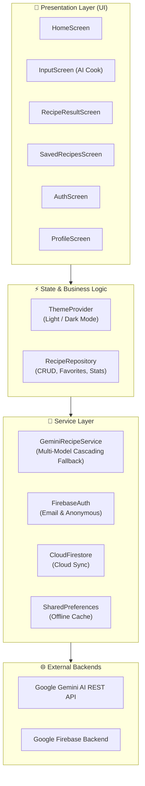

<div align="center">

  

  # 🍳 CookSmart AI

  ### *Smart Culinary Assistant Powered by Google Gemini & Flutter*

  <p align="center">
    Turn whatever ingredients are in your pantry into delicious, personalized recipes in seconds.
    Designed with a warm modern aesthetic, multi-tier AI cascading, offline-first storage, and crystal-clear plain English instructions.
  </p>

  <p align="center">
    <a href="https://flutter.dev"></a>
    <a href="https://dart.dev"></a>
    <a href="https://deepmind.google/technologies/gemini/"></a>
    <a href="https://firebase.google.com"></a>
    <a href="https://github.com/Abu-Sarfaraz/cooksmart/blob/master/LICENSE"></a>
  </p>

  <p align="center">
    <a href="#-key-features">Features</a> •
    <a href="#-architecture--tech-stack">Architecture</a> •
    <a href="#-screenshots--demo">Visuals</a> •
    <a href="#-getting-started">Getting Started</a> •
    <a href="#-project-structure">Project Structure</a> •
    <a href="#-testing">Testing</a>
  </p>

</div>

---

## 🌟 Key Features

### 🪄 1. Intelligent AI Recipe Creation
- **Ingredient-Based Cooking**: Type or tap pantry ingredients (e.g., chicken breast, tomatoes, garlic, rice) to instantly generate complete, flavorful meals.
- **Dietary & Lifestyle Filters**: Full support for Vegetarian, Vegan, Keto, Gluten-Free, Halal, High Protein, Low Carb, and Dairy-Free preferences.
- **Precision Parameters**: Select exact cooking time limits (15 min, 30 min, 45 min, 60+ min), serving sizes (1 to 6+), and meal courses (Breakfast, Lunch, Dinner, Snack, Dessert).

### 🗣️ 2. Plain English Language Guarantee
- **Accessible Instructions**: No confusing culinary jargon (no obscure terms like *"deglaze"*, *"julienne"*, or *"chiffonade"*).
- **Clear Everyday Steps**: All steps and ingredients are generated in simple, easy-to-follow English that any home cook can understand.

### ⚡ 3. Multi-Tier AI Fallback Engine
- **Intelligent Cascading**: Automatically balances speed, reasoning depth, and cost by categorizing queries into tiers:
  - **Tier 1 (Fast & Agile)**: Powered by `gemini-1.5-flash`, `gemini-2.0-flash`, and `gemini-1.5-flash-8b`.
  - **Tier 2 (Gourmet & Complex Diets)**: Backed by `gemini-1.5-flash`, `gemini-2.0-flash`, and `gemini-1.5-pro`.
- **In-Memory Cache**: Built-in LRU query cache prevents redundant API calls and eliminates unnecessary token usage.

### 🔄 4. Live Recipe Customization
- **On-the-Fly Tweaks**: Already have a recipe but want changes? Ask the AI to *"Make it spicier"*, *"Swap garlic for ginger"*, or *"Reduce calories"* with real-time dynamic re-generation.

### ☁️ 5. Dual-Layer Storage (Offline First + Cloud Sync)
- **Local Persistence**: All saved recipes and user stats are saved immediately to device storage (`SharedPreferences`).
- **Cloud Firestore**: Seamlessly backs up favorite recipes for authenticated users across multiple devices.
- **Pre-Loaded Curated Recipes**: Starts with hand-crafted meals ready to explore right after launch.

### 🎨 6. Calibrated Light & Dark Theme System
- Hand-tuned Material 3 design system featuring warm terracotta brand tones (`#FF6B00`), rich card elevation, smooth gradients, and persistent user theme preferences.

### 🛡️ 7. Friendly Exception Handling
- Zero raw error codes, socket dumps, or technical stack traces shown to users.
- Warm, helpful English messages with integrated **Retry** prompts for internet drops, timeouts, and busy servers.

---

## 🏗️ Architecture & Tech Stack

CookSmart follows a clean, reactive layered Flutter architecture powered by `provider`:



### Tech Stack Details

| Component | Technology | Description |
| :--- | :--- | :--- |
| **Framework** | [Flutter 3.x](https://flutter.dev) | Cross-platform UI toolkit |
| **Language** | [Dart 3.x](https://dart.dev) | High-performance client-optimized language |
| **AI Backend** | [Google Gemini REST API](https://ai.google.dev/) | Multimodal LLMs for recipe synthesis and adaptation |
| **State Management** | [`provider`](https://pub.dev/packages/provider) | Clean reactive dependency injection and state |
| **Authentication** | [`firebase_auth`](https://pub.dev/packages/firebase_auth) | Secure email authentication + anonymous guest login |
| **Cloud Storage** | [`cloud_firestore`](https://pub.dev/packages/cloud_firestore) | Real-time cloud document sync |
| **Local Storage** | [`shared_preferences`](https://pub.dev/packages/shared_preferences) | Fast offline key-value and JSON caching |
| **Networking** | [`http`](https://pub.dev/packages/http) | Resilient REST HTTP client with timeouts & retry logic |

---

## 📁 Project Structure

```text
cooksmart/
├── assets/
│   └── images/
│       ├── app_icon.jpg             # High-res application icon
│       └── logo.jpg                 # Brand banner & header artwork
├── lib/
│   ├── config/
│   │   ├── api_keys.dart            # API keys (gitignored for security)
│   │   └── api_keys.example.dart    # Template configuration file
│   ├── models/
│   │   └── recipe_model.dart        # Recipe, Ingredient, and Step models
│   ├── providers/
│   │   └── theme_provider.dart      # Dark/Light theme state & persistence
│   ├── screens/
│   │   ├── auth_screen.dart         # Login, Registration & Guest Mode
│   │   ├── home_screen.dart         # Featured recipes & smart quick-actions
│   │   ├── input_screen.dart        # Ingredient input, filters & AI generate
│   │   ├── profile_screen.dart      # User stats, theme toggle & cloud sync
│   │   ├── recipe_result_screen.dart# Cooking instructions, tips & tweaks
│   │   └── saved_recipes_screen.dart# Filterable recipe cookbook with search
│   ├── services/
│   │   ├── gemini_recipe_service.dart# Google Gemini multi-model API service
│   │   └── recipe_repository.dart   # Repository managing local & Firestore sync
│   ├── theme/
│   │   └── app_theme.dart           # Theme tokens, colors, and Material 3 styles
│   ├── utils/
│   │   └── debouncer.dart           # Input debounce utility for search
│   └── main.dart                    # Application entrypoint & shell navigation
├── test/
│   ├── error_handling_test.dart     # Friendly error message unit tests
│   ├── recipe_model_test.dart       # JSON serialization unit tests
│   └── widget_test.dart             # Full navigation & widget render tests
├── pubspec.yaml                     # Project dependencies & asset configs
└── README.md                        # Documentation
```

---

## 🚀 Getting Started

### Prerequisites

- [Flutter SDK](https://docs.flutter.dev/get-started/install) (`>= 3.0.0`)
- [Dart SDK](https://dart.dev/get-dart) (`>= 3.0.0`)
- A [Google Gemini API Key](https://aistudio.google.com/app/apikey) (Free tier available)
- (Optional) A [Firebase Project](https://console.firebase.google.com) for cloud features

### 1. Clone the Repository

```bash
git clone https://github.com/Abu-Sarfaraz/cooksmart.git
cd cooksmart
```

### 2. Install Dependencies

```bash
flutter pub get
```

### 3. Configure Your Gemini API Key

Copy the example configuration to create your local key file:

```bash
cp lib/config/api_keys.example.dart lib/config/api_keys.dart
```

Open `lib/config/api_keys.dart` and paste your Gemini API key:

```dart
// lib/config/api_keys.dart
const String geminiApiKey = 'YOUR_GEMINI_API_KEY_HERE';
```

> **Note**: `lib/config/api_keys.dart` is added to `.gitignore` to prevent secret exposure.

### 4. Run the Application

#### On Web (Local Browser):
```bash
flutter run -d chrome
```

#### On Web Server:
```bash
flutter run -d web-server --web-port=9090
```
Then visit `http://localhost:9090` in your browser.

#### On Connected Android Device / Emulator:
```bash
flutter run -d android
```

#### On Linux Desktop:
```bash
flutter run -d linux
```

---

## 🧪 Testing & Code Quality

CookSmart maintains strict code standards with full static analysis and unit/widget test coverage.

### Run Static Analysis
```bash
flutter analyze
```

### Run All Tests
```bash
flutter test
```

Test suites include:
- `test/widget_test.dart`: End-to-end UI rendering and navigation across all bottom tabs.
- `test/recipe_model_test.dart`: Serialization, deserialization, and schema integrity.
- `test/error_handling_test.dart`: Friendly error messaging validations.

---

## 🔒 Security & Privacy

- **API Key Protection**: Secrets are isolated in gitignored configuration files and protected against accidental commits.
- **Guest Access**: Full offline and guest support—no personal information required to use all cooking features.
- **Secure Cloud Storage**: User recipes in Cloud Firestore are scoped strictly to the authenticated user's ID (`users/{uid}/recipes`).

---

## 🤝 Contributing

Contributions, feedback, and suggestions are welcome!

1. Fork the Project
2. Create your Feature Branch (`git checkout -b feature/AmazingFeature`)
3. Commit your Changes (`git commit -m 'Add some AmazingFeature'`)
4. Push to the Branch (`git push origin feature/AmazingFeature`)
5. Open a Pull Request

---

## 📄 License

This project is open-source and available under the [MIT License](LICENSE).

<div align="center">
  <sub>Built with ❤️ by Abu Sarfaraz using Flutter & Google Gemini AI</sub>
</div>
